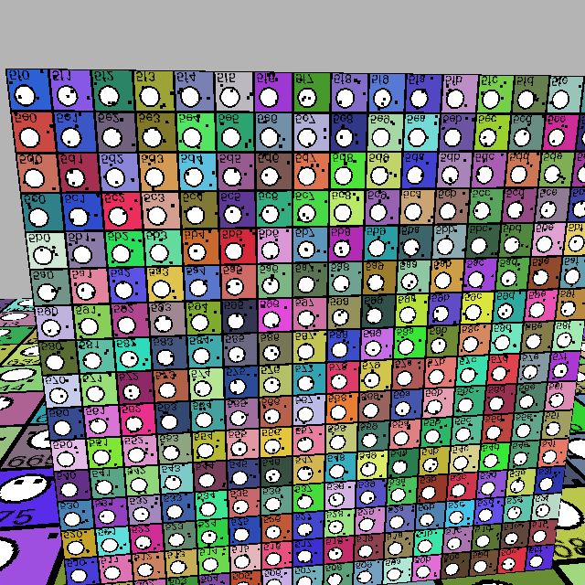
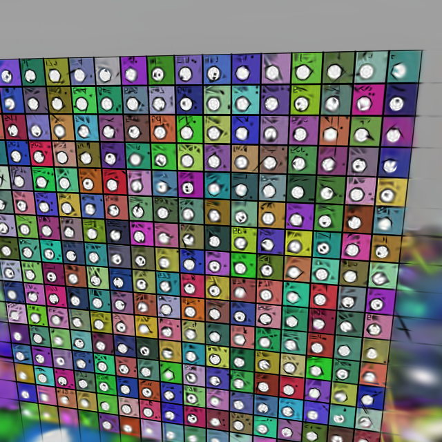
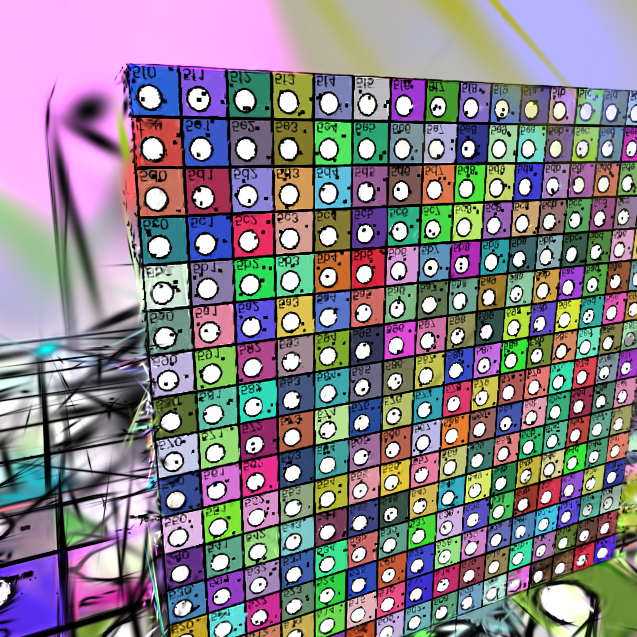
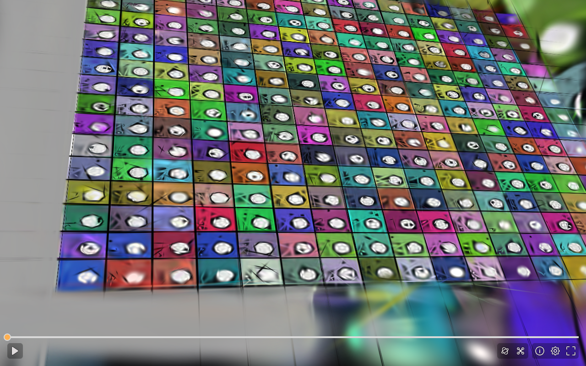

# Spirula evaluation — 29 October 2026

Spirula successfully ran native camera recovery and Gaussian training on a
temporary Runpod RTX 4090, and its output converted to SOG and rendered in the
same PlayCanvas SuperSplat Viewer package used by ARqary. This is an **operator
experiment**, not a deployed customer reconstruction service.

## Observed comparison

The input was our original generated textured cube: twelve 640×640 images, not a
physical property capture. Both experiments used nine training images and the
same three held-out source-frame identities: 00, 04 and 08. Each pipeline used
its own camera recovery and training recipe; this is not a controlled renderer
or algorithm benchmark. Neither model establishes apartment quality.

| Observation | Spirula v2026.10.16 | Existing gsplat 1.5.3 |
| --- | ---: | ---: |
| Registered source views | 12/12 | 12/12 |
| Training iterations | 3,000 | 3,000 |
| Training views / held-out views | 9 / 3 | 9 / 3 |
| Exported Gaussians | 12,724 | 131,680 |
| Mean held-out PSNR | 13.7658 dB | 15.4988 dB |
| Native training-stage wall time | 10.135 s | 11.078 s |

The gsplat timing is warm: an earlier all-image run also paid JIT compilation.
These numbers do not establish expected cost, throughput or a general speedup.
Spirula's native trainer reported 9.030 seconds of training in the initial run;
its final process stage includes additional process/setup/evaluation work.
Full final adapter execution took 16.722 seconds, including 6.175 seconds of SfM.

**Decision:** retain the existing production engine and keep Spirula opt-in.
The existing engine had the higher held-out score under these settings. Visual
inspection showed remaining artifacts and incomplete geometry; no quality
threshold or real-property acceptance is claimed. A bounds-fitted camera looked
at largely unobserved geometry, so the experiment now carries a captured
viewpoint, accounting for the scene transform and PlayCanvas's rotation.

## Delivery verification

The final finite, rotation-normalized PLY contains 12,724 Gaussians and is
3,157,082 bytes. PlayCanvas SplatTransform 3.10.3 converted it to a 381.7 KB SOG
in 39.939 seconds using CPU mode. Exact byte counts and independent local hashes
are recorded in `spirula-evaluation-20261029.json`.

Both PLY and SOG emitted a real first-frame callback at desktop 1280×800 and
mobile-layout 390×844 with zero JavaScript exceptions. Screenshots contain
rendered scene pixels. These were local software WebGL browser tests, not real
phone GPU performance or a published private website journey. A self-contained
HTML preview embeds the SOG; its verification is recorded separately.

## Runtime and cleanup

Pod `kmo05hz404blnb` used the official Runpod PyTorch Ubuntu 24.04 image and an
RTX 4090, NVIDIA driver 595.91.07, Vulkan 1.4.329. Initial CUDA health succeeded
while Vulkan failed: `libegl1` was missing. Installing EGL/GLX loader dependencies
made actual Vulkan instance/device discovery and subsequent training succeed.
The NVIDIA driver download used during diagnosis was not needed to replace the
host driver. Nothing changed on Basira or existing serverless endpoints.

The quoted compute rate was $0.89/hour, plus storage. Creation was
2026-10-29T14:39:27.501Z; deletion and an empty owned-pod listing were verified
before 14:53:09Z. This is lifecycle/rate evidence, not a reconciled invoice.
The temporary authenticated control credential was removed after termination.
No QA Auth user, customer record, private storage asset or production flag was
created/changed for this experiment. No Lovable agent credits were used.

## Source validation and remaining work

The opt-in adapter pins the release binary, bounds image count/bytes/pixels,
applies a shared deadline, checks registration, requires the exact final
checkpoint and finite held-out metrics, validates the Gaussian export and
records its digest. All 34 worker unit tests passed, including eight new process
and input boundary tests. The successful final native run preceded a small
float64 quaternion-norm hardening; the recorded GPU inference recipe and camera
logic were unchanged. Hosted checks and their outcome are reported independently.

Before a customer integration: accept representative owner-authorized apartment
captures (including walls, mirrors and low-texture rooms), compare budgets and
mobile performance, integrate with the existing owner-bound dispatch/settlement
and private-output receipt, verify a signed-in website journey, and complete
GPL/dependency distribution review. Direct video, 360 input, meshing and metric
accuracy were not tested or enabled. Existing customer-execution gates remain.

Installation and operator invocation: [experimental/README.md](experimental/README.md).

## Retained visual evidence

